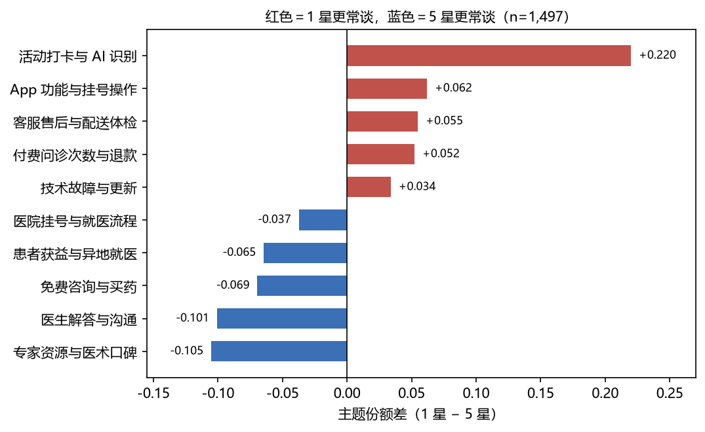
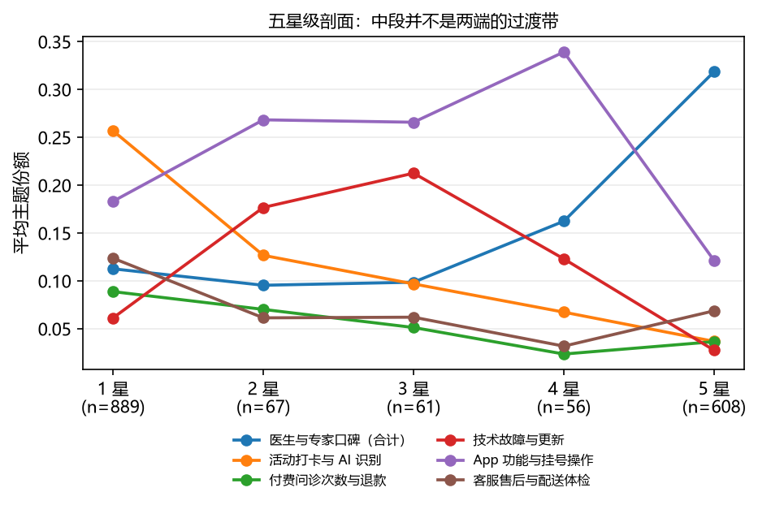

# 评分不是好坏，而是不同阶段的抱怨

用 8 个中国互联网医疗 App 的 **1,681 条 App Store 公开评论**做中文短文本主题建模（jieba + TF-IDF + NMF），
检验「评分」与「用户谈什么」之间的关系。

**核心结论**：评分与议题不是单调关系，而是**分段结构**——

| 星级 | 用户在谈什么 |
|---|---|
| 1 星 | 活动返利（+0.220）、付费问诊次数与退款（+0.052） |
| 2–4 星 | 技术故障（2 星达峰，+0.104，p=0.0025）、App 功能与挂号操作（4 星达峰，+0.107） |
| 5 星 | 医生与专家口碑（两主题合并 0.113 → 0.319，差值 −0.206，全表最大） |

只看两端会漏掉中段那批「还能用但很别扭」的用户。





## 材料

- **演示（10 页）**：在线版 https://owen9527tang.github.io/app-review-topic-modeling/app_review_project/outputs/app-review-deck/app-review-deck.html
  （本地版 `app_review_project/outputs/app-review-deck/app-review-deck.html`，支持 `?preview=N` 与 `#/N` 深链）
- **1 页 memo**：`app_review_project/outputs/memo.md`
- **主报告**：`app_review_project/outputs/topic_model.md`
- **详细文档与复现**：`app_review_project/README.md`

## 证据链

| 检验 | 做了什么 | 结果 | 报告 |
|---|---|---|---|
| 稳定性 | 多种子 10 / Bootstrap 50 / 跨 k=8/12/14 | 6/10 主题完全稳定，4 个会与相邻主题合并 | `stability.md` |
| 换算法 | NMF → LDA（同矩阵、同 k、同种子） | 7/10 主题方向同号；仅 2/10 可一一对应 | `algorithm_check.md` |
| 换范式 | bge 句向量 → UMAP → HDBSCAN | 33 簇、26.7% 噪声；技术故障簇 54% 为 2–4 星 | `bertopic_check.md` |
| 换比较范围 | 四类产品分组 + App×年/App×月 固定效应 | 8 个议题 7 个四类同号；收紧参照组后系数最大只动 0.014 | `heterogeneity.md` |
| 定性精读 | 68 条 AI 评论逐条编码 | 1 星骂识别与记忆失败（19/48），5 星夸报告解读（11/12） | `ai_read.md` |

## 项目结构

```
app_review_project/
├── scripts/            01 → 18，按序号执行即可复现
├── data/               原始与派生数据（评论全文不分发，见 data/README.md）
├── outputs/            报告、图、deck、memo
│   ├── topic_model.md      主报告（10 节）
│   ├── robustness.md       刷评排查 + 官方评分基准
│   ├── stability.md        多种子 / Bootstrap / 跨 k
│   ├── algorithm_check.md  NMF vs LDA
│   ├── bertopic_check.md   句向量 + UMAP + HDBSCAN 范式对照
│   ├── heterogeneity.md    产品类型分组 + App×月 固定效应
│   ├── ai_read.md          68 条 AI 评论定性精读
│   ├── coding_check.md     抽样机械基线 + 双人编码 κ（第一轮未达标，手册已改，待重编）
│   ├── figures/            8 张图
│   └── app-review-deck/    10 页 HTML 演示
├── codebook.md         codebook v0.2（11 类主题 + other + 人工编码手册）
└── README.md           流水线、复现命令、依赖与局限
```

## 方法要点

- **不做逐条人工标注**：极性由星级分组承担，主题模型只回答「在谈什么」；词表剔除纯极性词，否则主题会退化成「好评类 / 差评类」。
- **形状检验是关键一步**：把 2/3/4 星一并纳入 `share ~ C(rating) + App + 年份`，才看出中段的独立议题；只比两端会把它误记成 1 星专属。
- **三种固定效应口径并列报**：原始差值含 App 构成差异，固定效应系数是 App 内部比较，两者回答不同问题。

## 边界（主动交底）

- **只代表愿意写文字评论的人**：样本均值 2.66 vs 官方加权 4.55，7/8 个 App 低于官方（符号检验 p=7.8e-03）。
- **样本量有硬上限**：RSS 每 App 最多 10 页，深页多为 2016–2021 年老评论；1,681 条是「近期 + 时间干净」条件下的实际值，不靠老评论凑数。
- **只做关联**：评分与文本同时产生，不宣称因果。
- **「5 星更空泛」仍是代理指标**：字符数 44 vs 36、无主题关键词 29.1% vs 15.4%；双人编码第一轮 κ 仅 0.13/0.07，按预定规则不采用，手册已改为可操作测试并待重编，见 `coding_check.md`。

## 数据

评论全文不分发（可能含用户自述的健康信息）。仓库只保留聚合与派生数据，字段说明见
`app_review_project/data/README.md`。
